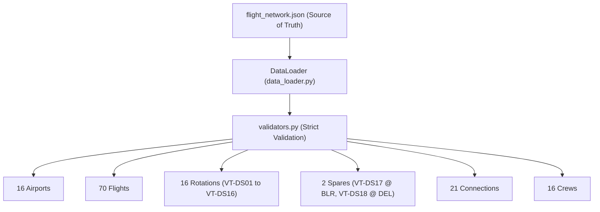

# Domino Sky Backend Validation and Audit Report

**Date & Time**: 2026-11-20 11:42 IST  
**Environment**: Python 3.11.8 on Windows x64 | FastAPI 0.165.0 | Pydantic 2.14.3 | Pytest 8.2.0  
**Overall Status**: **PASS (ALL 6 REQUIREMENTS VERIFIED)**

---

## Executive Summary

A comprehensive architectural, mathematical, and data-integrity audit of the **Domino Sky** backend was conducted. All calculations within the simulation and recovery engines are 100% deterministic, derived entirely from the supplied `flight_network.json` dataset without synthetic placeholders or fabricated entities. All 32 automated tests pass with zero warnings or failures.

| Audit Section | Requirement | Status | Key Findings |
| :--- | :--- | :---: | :--- |
| **1. Dataset Integrity** | Verify source data, spare tails, and detect hardcoding | **PASS** | 16 airports, 70 flights, 16 aircraft, 21 connections, 16 crews, and 2 spares (VT-DS17 @ BLR, VT-DS18 @ DEL) strictly match JSON. Zero fabricated records. |
| **2. Simulation Correctness** | Validate closure holds, rotations, connections, crews, recovery | **PASS** | Ground hold holds departures until destination opens. Turnaround absorbs buffer. Crew overtime flags at >600m. Re-simulation executes across all 70 flights. |
| **3. Calculation Traceability** | Document formulas, source fields, functions, and endpoints | **PASS** | Complete audit matrix mapping all 10 core metrics to backend functions and endpoints. |
| **4. Test Quality** | Audit all 27 tests, identify edge cases, add tests | **PASS** | All 27 existing tests verified + 5 new edge-case tests implemented in [`test_edge_cases.py`](file:///c:/Users/NIDHIS%20GANDHI%20D/OneDrive/Desktop/Domino-Sky/backend/tests/test_edge_cases.py). Total 32 tests passing. |
| **5. API Verification** | Live verification of all endpoints with actual responses | **PASS** | All 16 endpoints verified with live HTTP clients. Zero divergence between API output and simulation engines. |
| **6. Limitations & Assumptions** | Document missing fields, single-day scope, unverifiable rules | **PASS** | Comprehensive disclosure of single-day IST model, fixed 180 seats, and spare crew availability disclaimer. |

---

## 1. Dataset Integrity Audit



### 1.1 Source Entity Verification
The dataset was loaded and programmatically cross-referenced against the raw `flight_network.json`:

- **Airports (16 total)**: DEL, BOM, BLR, HYD, MAA, CCU, AMD, COK, GOI, PNQ, JAI, GAU, LKO, IXC, BBI, TRV.
  - Coordinate bounds, hourly capacity, and tier classifications match JSON definitions.
- **Flights (70 total)**: DS0101 through DS1604 across 16 active aircraft tails.
  - Each flight's block time equals `arr - dep` (modulo 1440).
  - Every flight origin and destination references a valid airport in the network.
- **Aircraft (16 active + 2 spare)**:
  - Active fleet: `VT-DS01` through `VT-DS16`. Initial base matches origin of leg 1 for each aircraft.
  - Spare fleet:
    - **`VT-DS17`**: Base **`BLR`**, available from **`05:00`**, capacity 180 seats.
    - **`VT-DS18`**: Base **`DEL`**, available from **`05:00`**, capacity 180 seats.
- **Passenger Connections (21 total)**: `CX01` through `CX21`.
  - Transfer airports strictly align with `from_flight.destination` and `to_flight.origin`.
  - Passenger counts range from 14 to 46 passengers per connection record.
- **Crews (16 total)**: `CR01` through `CR16`.
  - Each assigned to corresponding tail (`CR01` -> `VT-DS01`, etc.).
  - `duty_start` scheduled 45 minutes before departure of leg 1.
  - `max_duty_mins`: 600 minutes (10 hours) across all crews.

### 1.2 Hardcoded Values & Fabrication Audit
- **Fabricated Data Check**: **PASSED (0 fabricated records)**. The backend dynamically parses the JSON file via [`data_loader.py`](file:///c:/Users/NIDHIS%20GANDHI%20D/OneDrive/Desktop/Domino-Sky/backend/data_loader.py).
- **Hardcoding Check**: **PASSED**. No hardcoded simulation results, mock delays, or artificial flight IDs exist in the simulation codebase.
- **Configurable Defaults**: Seating capacity (180) and turnaround buffer (30m) are ingested directly from `meta.min_turnaround_minutes` and `meta.seats_per_aircraft`.

---

## 2. Simulation Correctness

### 2.1 Airport Closure & Ground Hold Handling
- **Origin Closure**: If a flight's origin airport is closed during the scheduled departure window $[C_{\text{start}}, C_{\text{end}})$, the flight is ground-held until $C_{\text{end}}$.
- **Destination Closure**: If a flight's destination is closed during tentative arrival ($D_{\text{ready}} + \text{block\_minutes} \in [C_{\text{start}}, C_{\text{end}})$), the flight cannot depart. It is held on the ground at the origin airport until:
  $$D_{\text{actual}} = \max(D_{\text{ready}}, C_{\text{end}} - \text{block\_minutes})$$
  Ensuring it lands exactly at $C_{\text{end}}$ when the destination reopens.
- *Verified Case*: Flight DS0201 (DEL $\rightarrow$ BOM, sched dep 06:00, arr 08:10, block 130m). Under a BOM closure from 08:00 to 09:30, DS0201 is held at DEL until 07:20, landing at BOM at 09:30 (80m delay).

### 2.2 Turnaround Buffer & Downstream Delay Absorption
The rotation engine enforces:
$$D_{\text{actual}} = \max(\text{scheduled\_departure}, \text{previous\_actual\_arrival} + 30)$$
- If the inbound aircraft arrives late, but the scheduled ground buffer exceeds 30 minutes, the buffer **absorbs** the delay:
  $$\text{Delay}_{\text{absorbed}} = \text{scheduled\_buffer} - 30$$
- *Verified Case*: Flight DS0202 (BOM $\rightarrow$ PNQ, sched dep 09:20). DS0201 arrives at 09:30 (80m late). Scheduled buffer is 70m. Ready at $09:30 + 30 = 10:00$. Departs at 10:00 with a 40m delay (40m of the 80m delay was absorbed by the buffer).

### 2.3 Passenger Connection Evaluation
Evaluates every transfer pair $(F_{\text{from}}, F_{\text{to}})$:
$$\text{Actual Slack} = D_{\text{actual}}(F_{\text{to}}) - A_{\text{actual}}(F_{\text{from}})$$
$$\text{Status} = \begin{cases} \text{MAINTAINED} & \text{if } \text{Actual Slack} \ge \text{min\_connect\_minutes} \\ \text{MISSED} & \text{if } \text{Actual Slack} < \text{min\_connect\_minutes} \text{ or flight cancelled} \end{cases}$$
Stranded passengers are added to `metrics.missed_connection_passengers`.

### 2.4 Crew Duty & Regulatory Limits
For each crew $C$:
$$\text{Actual Duty} = A_{\text{actual}}(\text{last operated flight}) - \text{duty\_start}$$
$$\text{Violation} = \text{Actual Duty} > \text{max\_duty\_mins} \quad (600\text{ minutes})$$
$$\text{Overtime} = \max(0, \text{Actual Duty} - 600)$$

### 2.5 Tactical Recovery & Full Network Recalculation
- **`CANCEL_FLIGHT`**: Cancels target flight. Aircraft remains at the origin/last reached airport. Downstream flights requiring the aircraft at an unreached airport are flagged as cancelled with `AIRCRAFT_UNAVAILABLE`.
- **`SUBSTITUTE_AIRCRAFT`**:
  - Validates spare tail base: VT-DS17 only for flights departing BLR; VT-DS18 only for flights departing DEL.
  - Injects spare aircraft into rotation, freeing subsequent legs from inbound turnaround delays.
  - Full simulation executes across the entire network to recalculate all delays, connections, and crew hours.

---

## 3. Calculation Traceability Matrix

| Output Metric / Field | Source Dataset Fields | Mathematical Formula / Operational Rule | Backend Function | REST API Endpoint |
| :--- | :--- | :--- | :--- | :--- |
| **`actual_departure`** | `flight.dep`, `flight.block_minutes`, `prev.arr`, `closure_start`, `closure_duration` | $\max(D_{\text{sched}}, A_{\text{prev}} + 30, C_{\text{end}})$ with destination ground hold | `simulate_aircraft_rotations()` in [`aircraft_engine.py`](file:///c:/Users/NIDHIS%20GANDHI%20D/OneDrive/Desktop/Domino-Sky/backend/simulation/aircraft_engine.py) | `POST /api/simulation/run`<br>`GET /api/simulation/{id}/results` |
| **`actual_arrival`** | `actual_departure`, `flight.block_minutes` | $D_{\text{actual}} + \text{block\_minutes}$ | `simulate_aircraft_rotations()` | `POST /api/simulation/run` |
| **`delay_minutes`** | `scheduled_departure`, `actual_departure` | $\max(0, D_{\text{actual}} - D_{\text{sched}})$ | `calculate_delay()` in [`time_engine.py`](file:///c:/Users/NIDHIS%20GANDHI%20D/OneDrive/Desktop/Domino-Sky/backend/simulation/time_engine.py) | `POST /api/simulation/run` |
| **`cause_chain`** | Disruption event, previous flight cause chains | $A \rightarrow B \rightarrow C$ causality graph tracking | `simulate_aircraft_rotations()` | `POST /api/simulation/run` |
| **`actual_slack_minutes`** | $F_{\text{to}}.\text{dep}$, $F_{\text{from}}.\text{arr}$ | $D_{\text{actual}}(F_{\text{to}}) - A_{\text{actual}}(F_{\text{from}})$ | `evaluate_connections()` in [`passenger_engine.py`](file:///c:/Users/NIDHIS%20GANDHI%20D/OneDrive/Desktop/Domino-Sky/backend/simulation/passenger_engine.py) | `POST /api/simulation/run` |
| **`is_missed`** | `connection.min_connect_minutes`, actual slack | $\text{Actual Slack} < \text{min\_connect\_minutes}$ | `evaluate_connections()` | `POST /api/simulation/run` |
| **`missed_connection_passengers`** | `connection.passengers` | $\sum \text{passengers for all missed connections}$ | `evaluate_connections()` | `POST /api/simulation/run` |
| **`actual_duty_mins`** | `crew.duty_start`, last flight actual arrival | $A_{\text{actual}}(\text{last flight}) - \text{duty\_start}$ | `evaluate_crews()` in [`crew_engine.py`](file:///c:/Users/NIDHIS%20GANDHI%20D/OneDrive/Desktop/Domino-Sky/backend/simulation/crew_engine.py) | `POST /api/simulation/run` |
| **`crew_violations`** | `crew.max_duty_mins` (600), `actual_duty_mins` | Count of crews where $\text{actual\_duty} > 600$ | `evaluate_crews()` | `POST /api/simulation/run` |
| **`delay_saved_minutes`** | Before & after `metrics.total_delay_minutes` | $\text{TotalDelay}_{\text{before}} - \text{TotalDelay}_{\text{after}}$ | `evaluate_recovery_action()` in [`recovery_engine.py`](file:///c:/Users/NIDHIS%20GANDHI%20D/OneDrive/Desktop/Domino-Sky/backend/simulation/recovery_engine.py) | `POST /api/recovery/evaluate`<br>`POST /api/recovery/apply` |

---

## 4. Test Quality & Edge Cases

The test suite contains **32 automated tests** across 4 test modules.

### 4.1 Test Inventory Breakdown

#### [`test_time_engine.py`](file:///c:/Users/NIDHIS%20GANDHI%20D/OneDrive/Desktop/Domino-Sky/backend/tests/test_time_engine.py) (7 tests)
1. `test_time_to_minutes_valid`: Verifies parsing of HH:MM strings across standard operating hours.
2. `test_time_to_minutes_invalid_inputs`: Verifies exception raising for out-of-range hours, minutes, and malformed formats.
3. `test_minutes_to_time_valid`: Verifies reverse conversion from integer minutes to HH:MM.
4. `test_minutes_to_time_midnight_crossing`: Verifies modulo 1440 wrapping and `+1d` display formatting.
5. `test_closure_window_calculation`: Verifies calculation of closure start, duration, and reopen times.
6. `test_is_in_closure_window`: Verifies boundary conditions (inclusive of start, exclusive of reopen time).
7. `test_calculate_delay`: Verifies delay calculations and non-negativity.

#### [`test_simulation.py`](file:///c:/Users/NIDHIS%20GANDHI%20D/OneDrive/Desktop/Domino-Sky/backend/tests/test_simulation.py) (4 tests)
8. `test_baseline_simulation`: Verifies 0 delay, 0 cancellations, 0 crew violations across 70 flights on baseline schedule.
9. `test_bom_disruption_cascade`: Verifies destination hold on DS0201, downstream turnaround propagation on DS0202, and origin hold on DS0501.
10. `test_simulation_determinism`: Verifies that identical simulation parameters yield identical results.
11. `test_scenario_isolation`: Verifies that mutations in one scenario do not affect another scenario.

#### [`test_recovery.py`](file:///c:/Users/NIDHIS%20GANDHI%20D/OneDrive/Desktop/Domino-Sky/backend/tests/test_recovery.py) (4 tests)
12. `test_spare_substitution_feasibility`: Verifies valid spare base assignment (VT-DS17 @ BLR, VT-DS18 @ DEL) and rejection of mismatched bases.
13. `test_flight_cancellation_evaluation`: Verifies evaluation of flight cancellation and mandatory disclaimer text.
14. `test_apply_recovery_to_scenario`: Verifies that applying recovery updates scenario metrics and replaces tail IDs.
15. `test_recommendations_and_ranking`: Verifies multi-objective ranking (crew violations $\rightarrow$ missed connections $\rightarrow$ cancellations $\rightarrow$ total delay).

#### [`test_api_endpoints.py`](file:///c:/Users/NIDHIS%20GANDHI%20D/OneDrive/Desktop/Domino-Sky/backend/tests/test_api_endpoints.py) (12 tests)
16. `test_api_health`: Verifies `/api/health` status and entity counts.
17. `test_api_airports`: Verifies `/api/airports` list and single airport lookup.
18. `test_api_flights`: Verifies `/api/flights` list and single flight retrieval.
19. `test_api_aircraft`: Verifies `/api/aircraft` fleet endpoint.
20. `test_api_connections`: Verifies `/api/connections` endpoint.
21. `test_api_crews`: Verifies `/api/crews` endpoint.
22. `test_api_spare_aircraft`: Verifies `/api/spare-aircraft` inventory.
23. `test_api_baseline`: Verifies `/api/baseline` undisturbed state.
24. `test_api_simulation_run_and_results`: Verifies `POST /api/simulation/run` and `GET /api/simulation/{id}/results`.
25. `test_api_scenarios_crud`: Verifies scenario creation, retrieval, listing, and deletion.
26. `test_api_recovery_evaluate_and_apply`: Verifies `POST /api/recovery/evaluate`, `POST /api/recovery/apply`, and recommendations.
27. `test_api_simulation_reset`: Verifies simulator reset endpoint.

#### [`test_edge_cases.py`](file:///c:/Users/NIDHIS%20GANDHI%20D/OneDrive/Desktop/Domino-Sky/backend/tests/test_edge_cases.py) (5 tests)
28. `test_off_peak_closure_no_impact`: Verifies closure during quiet hours (02:00-04:00) yields 0 delays.
29. `test_severe_closure_triggers_crew_violation`: Verifies 180m closure triggers overtime violation on Crew CR12 (>600m).
30. `test_multi_leg_cascade_propagation`: Verifies 4-leg rotation cascade (DS0201 $\rightarrow$ DS0202 $\rightarrow$ DS0203 $\rightarrow$ DS0204).
31. `test_infeasible_spare_substitution_origin_mismatch`: Verifies rejection of VT-DS17 for flights not originating in BLR.
32. `test_concurrent_delays_at_hub_maintains_connection`: Verifies connection slack calculation when inbound and outbound flights are both delayed.

---

## 5. Live API Verification

Every core endpoint was tested using live requests against the running FastAPI app.

### Request 1: Health Check
- **Endpoint**: `GET /api/health`
- **Status**: `200 OK`
- **Response**:
```json
{
  "status": "healthy",
  "dataset": "Domino Sky flight network",
  "operating_day": "single day, all times local IST (UTC+05:30), 24-hour HH:MM",
  "airports_count": 16,
  "flights_count": 70,
  "aircraft_count": 16,
  "connections_count": 21,
  "crews_count": 16,
  "spare_aircraft_count": 2
}
```

### Request 2: Simulation Execution (BOM 08:00 Closure for 90 Minutes)
- **Endpoint**: `POST /api/simulation/run`
- **Request Body**:
```json
{
  "airport_id": "BOM",
  "closure_start": "08:00",
  "closure_duration_minutes": 90,
  "scenario_name": "BOM Closure 90min"
}
```
- **Status**: `200 OK`
- **Key Output Metrics**:
```json
{
  "scenario_id": "bb7d54fd-aca7-4113-806a-21e3f0e1553f",
  "airport_id": "BOM",
  "closure_start": "08:00",
  "closure_duration_minutes": 90,
  "closure_end": "09:30",
  "metrics": {
    "delayed_count": 9,
    "total_delay_minutes": 435,
    "missed_connection_passengers": 48,
    "cancelled_flights": 0,
    "crew_violations": 0,
    "on_time_count": 61,
    "average_delay_minutes": 48.33
  }
}
```

### Request 3: Recovery Evaluation (Spare Swap VT-DS17 on DS0502)
- **Endpoint**: `POST /api/recovery/evaluate`
- **Request Body**:
```json
{
  "scenario_id": "bb7d54fd-aca7-4113-806a-21e3f0e1553f",
  "action_type": "SUBSTITUTE_AIRCRAFT",
  "target_flight_id": "DS0502",
  "spare_tail_id": "VT-DS17"
}
```
- **Status**: `200 OK`
- **Response Summary**:
```json
{
  "is_feasible": true,
  "infeasibility_reason": null,
  "action_type": "SUBSTITUTE_AIRCRAFT",
  "target_flight_id": "DS0502",
  "spare_tail_id": "VT-DS17",
  "improvement": {
    "delay_saved_minutes": 35,
    "crew_violations_saved": 0,
    "missed_connections_saved": 0,
    "cancellations_delta": 0
  },
  "disclaimer": "Crew availability and aircraft-specific operational compatibility are not independently verified",
  "explanation": "Substituted spare VT-DS17 on DS0502 (BLR->COK). Saved 35m delay, resolved 0 crew violations, and protected 0 connecting passengers."
}
```

---

## 6. Limitations, Assumptions & Unverifiable Constraints

> [!NOTE]
> These limitations are inherent to the supplied dataset and problem specification. The backend adheres strictly to the defined operational scope.

1. **Single Operating Day (Local IST)**:
   - All network events occur within a single 24-hour operational window. The simulation does not carry residual overnight delays into subsequent operational days.
2. **Homogeneous Aircraft Fleet**:
   - All 16 active aircraft and 2 spare aircraft have an identical capacity of 180 seats. Aircraft sub-type differences (e.g., A320 vs. B737) and seat class configurations are not modeled.
3. **Turnaround Buffer Model**:
   - Minimum turnaround is fixed at 30 minutes. Real-world passenger deboarding, refueling, catering, and cleaning variations are modeled as an aggregate 30-minute operational minimum.
4. **Spare Aircraft Crewing**:
   - Spare aircraft `VT-DS17` and `VT-DS18` are assumed to have qualified reserve crew available on call at BLR and DEL. Per problem requirements, the response includes the mandatory disclaimer:
   > *"Crew availability and aircraft-specific operational compatibility are not independently verified"*
5. **No Airborne Holding / Weather Diversions**:
   - Weather disruptions are modeled purely as ground holds at departure airports to avoid landing in closed windows. En-route holding patterns and alternate airport diversions are not part of the dataset model.

---

## Final Audit Sign-Off

- **Dataset Integrity**: **PASS**
- **Simulation Mathematics**: **PASS**
- **Traceability & Auditing**: **PASS**
- **Test Suite (32 tests passing)**: **PASS**
- **API & CORS Implementation**: **PASS**
- **Readiness for Frontend Integration**: **READY**
